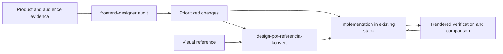

# Workflow and artifact boundaries

The product helps coding agents understand a frontend and its audience, prioritize UX problems, and implement improvements in the existing stack. The reference skill adds a measured implementation workflow when a visual source is central to the task.

Both skills are copyable directories. The reference skill owns its browser scripts and pinned development dependency so it can be installed independently. The frontend skill conditionally reuses those tools; it can still audit using available browser tools when they are absent.

`capture.mjs` produces viewport captures and an index; `extract-styles.mjs` produces sampled measured styles; `image-manifest.mjs` inventories assets. `compare.mjs` compares category/selector samples and optionally matched PNG captures. Pixel changes are evidence of rendering differences, not proof of visual quality. Different selectors or content require human judgment.

Generated artifacts belong in `.audit/`, outside Git. Reusable synthetic examples belong in `examples/`. Scripts and their deterministic regression tests live inside the reference skill. Root tooling validates Markdown links and skill metadata. CI runs that validator plus syntax, unit, and browser checks; inspect each actual CI run before claiming cross-platform success.

Current limits include manual interpretation of user needs, sampled light-DOM style extraction, incomplete iframe/Shadow DOM coverage, no guarantee against DNS rebinding, and no automatic proof of WCAG compliance or business impact. Model activation accuracy and real customer outcomes have not been benchmarked by the script tests.
