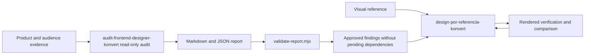

# Workflow and artifact boundaries

The audit skill examines a frontend and its audience without changing the project, then produces prioritized findings. The executor implements only approved findings or adapts a visual reference, and verifies the rendered result.

Both skills are copyable directories installed side by side. The executor owns its browser scripts and pinned development dependency and can be used alone. The auditor depends on those scripts for rendered evidence; without them it falls back to read-only inspection and reports the missing evidence, without installing dependencies or changing the audited project. `verify-install.mjs` therefore requires both.

The handoff contract is checked structurally by `audit-frontend-designer-konvert/scripts/validate-report.mjs` (zero dependencies); it cannot authenticate user approval. A finding is implementable only when `approved_for_implementation` is true and `external_dependency.status` is `not_applicable` or `resolved`; `--implementable --approved-ids <ids>` intersects eligible findings with IDs independently authorized by the user; the tool cannot authenticate that authorization. Version 1 reports are read with every described dependency treated as pending, because version 1 could not record a resolution.

`capture.mjs` produces viewport captures and an index; `extract-styles.mjs` produces sampled measured styles; `image-manifest.mjs` inventories assets. `compare.mjs` compares category/selector samples and optionally matched PNG captures. Pixel changes are evidence of rendering differences, not proof of visual quality. Different selectors or content require human judgment.

Generated artifacts belong in `.audit/`, outside Git. Reusable synthetic examples belong in `examples/`. Browser scripts and their regression tests live inside the reference skill; the report validator and its tests live inside the auditor. Root tooling validates Markdown links, skill metadata, the report contract on the synthetic example, and evaluation cases. `evaluations/` holds synthetic fixtures, an answer key for audit quality, and a file-level handoff scope check; their scorers never call a model. CI runs the validators plus syntax, unit, and browser checks; inspect each actual CI run before claiming cross-platform success.

Current limits include manual interpretation of user needs, sampled light-DOM style extraction, incomplete iframe/Shadow DOM coverage, DNS pinning that covers HTTP and WebSocket traffic through a local proxy but not WebRTC/UDP, file-level rather than line-level handoff checks, and no automatic proof of WCAG compliance or business impact. Model activation accuracy, audit quality, handoff compliance, and real customer outcomes have not been measured: the evaluation tooling is ready, but no agent run has been recorded.
