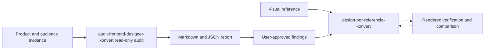

# Workflow and artifact boundaries

The audit skill examines a frontend and its audience without changing the project, then produces prioritized findings. The executor implements only approved findings or adapts a visual reference, and verifies the rendered result.

Both skills are copyable directories. The executor owns its browser scripts and pinned development dependency so it can be installed independently. The auditor uses those scripts for rendered evidence when they are installed; otherwise it reports the evidence limitation and uses available read-only inspection without installing dependencies or changing the audited project.

`capture.mjs` produces viewport captures and an index; `extract-styles.mjs` produces sampled measured styles; `image-manifest.mjs` inventories assets. `compare.mjs` compares category/selector samples and optionally matched PNG captures. Pixel changes are evidence of rendering differences, not proof of visual quality. Different selectors or content require human judgment.

Generated artifacts belong in `.audit/`, outside Git. Reusable synthetic examples belong in `examples/`. Scripts and their deterministic regression tests live inside the reference skill. Root tooling validates Markdown links and skill metadata. CI runs that validator plus syntax, unit, and browser checks; inspect each actual CI run before claiming cross-platform success.

Current limits include manual interpretation of user needs, sampled light-DOM style extraction, incomplete iframe/Shadow DOM coverage, no guarantee against DNS rebinding, and no automatic proof of WCAG compliance or business impact. Model activation accuracy and real customer outcomes have not been benchmarked by the script tests.
